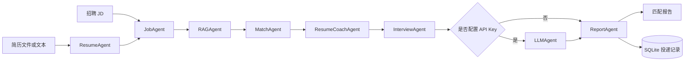

# CareerPilot Agent

基于 **Python + LangGraph + FastAPI + Gradio** 的多智能体求职助手。系统读取简历和招聘 JD，依次完成结构化解析、轻量 RAG 检索、可解释人岗匹配、简历优化建议、模拟面试题生成和投递状态管理。

项目默认运行在 **Demo 模式**：不需要 API Key，不会产生模型费用。有 OpenAI 或 OpenAI 兼容 API 时，可以在 `.env` 中启用大模型个性化增强。

> 重要原则：系统只根据简历中的已有事实给建议，不会为了提高匹配度编造技能、经历或项目数据。

## 项目亮点

- 使用 LangGraph 编排 7～8 个有状态节点，展示状态、节点、边和条件路由；
- 支持 PDF、DOCX、TXT、Markdown 简历解析；
- 使用 Pydantic 定义简历、岗位、评分、建议和面试题等结构化数据；
- 匹配分数由必备技能、加分技能、关键词和项目证据四部分组成，可解释、可复现；
- 内置轻量 RAG 基线，不下载 Embedding 模型也能检索本地求职知识；
- 提供 Gradio 演示页面和 FastAPI REST API；
- 使用 SQLite 管理投递记录和分析快照；
- API 未配置或调用失败时自动降级，保证演示可用；
- 包含自动测试、示例简历、示例 JD、项目讲解稿和简历描述。

## 系统架构



工作流中的共享状态由 `CareerState` 定义。每个 Agent 节点只负责一个明确任务，并将结构化结果写回状态。`InterviewAgent` 后使用条件边判断是否需要调用大模型；未配置密钥时直接进入 `ReportAgent`。

## 目录结构

```text
career-pilot-agent/
├─ src/career_pilot/
│  ├─ workflow.py       # LangGraph 工作流
│  ├─ parsers.py        # PDF/DOCX/TXT/MD 和 JD 解析工具
│  ├─ matching.py       # 可解释匹配算法
│  ├─ agents.py         # 简历建议与面试题 Agent
│  ├─ knowledge.py      # 轻量 RAG 检索器
│  ├─ llm.py            # OpenAI/兼容 API 增强与结构化输出
│  ├─ database.py       # SQLite 投递管理
│  ├─ api.py            # FastAPI 接口
│  └─ ui.py             # Gradio 页面
├─ knowledge/           # 本地求职知识库
├─ examples/            # 可直接演示的简历和 JD
├─ tests/               # 自动测试
├─ docs/                # 简历描述和面试讲解
├─ setup.bat            # Windows 一键安装
├─ run_ui.bat           # Windows 一键启动页面
└─ run_api.bat          # Windows 一键启动 API
```

## Windows 快速开始

系统要求 Python 3.11 或更高版本。项目已经适配“不允许执行 PowerShell 脚本”的电脑，不需要运行 `Activate.ps1`。

### 方法一：双击运行

1. 双击 `setup.bat`，等待依赖安装完成；
2. 双击 `run_ui.bat`；
3. 浏览器打开 <http://127.0.0.1:7860>；
4. 点击页面中的“载入示例”；
5. 点击“开始多 Agent 分析”。

### 方法二：PowerShell 命令

```powershell
cd career-pilot-agent
py -3.12 -m venv .venv
.\.venv\Scripts\python.exe -m pip install -e ".[dev]"
Copy-Item .env.example .env
.\.venv\Scripts\python.exe -m career_pilot.ui
```

全程使用虚拟环境中的 Python，不需要激活虚拟环境。

## 启动 FastAPI

双击 `run_api.bat`，或运行：

```powershell
.\.venv\Scripts\python.exe -m career_pilot.api
```

启动后访问：

- API 文档：<http://127.0.0.1:8000/docs>
- 健康检查：<http://127.0.0.1:8000/health>
- 文本分析：`POST /api/v1/analyze`
- 文件分析：`POST /api/v1/analyze-file`
- 投递记录：`GET/POST /api/v1/applications`

文本分析示例：

```json
{
  "resume_text": "这里粘贴至少 20 个字符的简历文字",
  "jd_text": "这里粘贴至少 20 个字符的招聘 JD",
  "company": "示例公司",
  "role": "AI Agent 应用开发工程师"
}
```

## 运行测试

```powershell
.\.venv\Scripts\python.exe -m pytest -q
```

测试覆盖：

- 简历和 JD 结构化解析；
- 文件类型和错误输入校验；
- 完整 LangGraph 工作流；
- 报告生成和导出；
- SQLite 投递记录的增删改查。

## 启用大模型增强（可选）

首次运行后会生成 `.env`。默认内容是：

```dotenv
LLM_PROVIDER=demo
```

### OpenAI

```dotenv
LLM_PROVIDER=openai
OPENAI_API_KEY=你的密钥
OPENAI_MODEL=gpt-5-mini
```

OpenAI 路径使用 Responses API 的 `responses.parse` 和 Pydantic 结构化输出。API Key 只放在本机 `.env`，该文件已被 `.gitignore` 排除。

### OpenAI 兼容接口

```dotenv
LLM_PROVIDER=compatible
LLM_API_KEY=你的密钥
LLM_BASE_URL=兼容接口地址
LLM_MODEL=模型名称
```

是否支持 JSON 输出取决于服务提供商。调用失败时系统会保留规则分析结果，并在报告中显示降级警告。

## 匹配算法

综合分数不是模型凭感觉生成，而是以下四部分的加权结果：

| 维度 | 权重 | 说明 |
|---|---:|---|
| 必备技能覆盖 | 55% | 简历是否覆盖 JD 明确要求的核心技术 |
| 加分技能覆盖 | 15% | 简历是否覆盖 JD 的加分项 |
| JD 关键词覆盖 | 15% | 整体技术关键词交集 |
| 项目证据质量 | 15% | 技能是否能在项目或经历原文中找到依据 |

当前版本是可解释基线，后续可以增加同义词向量匹配、岗位级权重学习和人工标注评测集。

## 项目安全与隐私

- Demo 模式下简历内容不发送给任何模型服务；
- SQLite 数据只保存在本机 `data/applications.db`；
- `.env` 和数据库文件不会被 Git 提交；
- 大模型增强前会移除邮箱和手机号；
- 系统明确提示不能编造简历内容；
- 对外部署前仍应增加登录、文件病毒检查、访问控制和数据删除机制。

## 项目来源说明

本项目是独立实现，工作流设计参考了 LangChain 官方教学仓库 [deep_research_from_scratch](https://github.com/langchain-ai/deep_research_from_scratch) 中“Scope → Research → Write”的分阶段 Agent 思想，并将其重新设计为求职场景下的简历解析、岗位分析、RAG、匹配、建议和面试工作流。代码、数据模型、页面、数据库和测试均在本项目中重新实现。

项目采用 MIT License。参考上游项目同样采用 MIT License。

## 简历和面试材料

- [简历项目描述](docs/RESUME_BULLETS.md)
- [面试讲解手册](docs/INTERVIEW_GUIDE.md)
