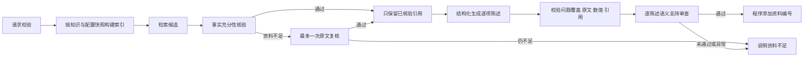

# v5.1 完整问答证据链与请求边界

已完成 35 题真实初评与 11 道失败题复测。两套依赖环境各 407 项回归通过；实际模型仍有语义误拒，详见 [真实评测与修复报告](RAG_LIVE_V5_1.md)。

## 标准问答路径

- 首次核验无效或服务异常时直接停止，只有“资料不足”会触发最多一次复核。复核仍走同一套原文和数值检查，不自动将否定改成支持。
- 生成阶段仅接收已核验的原文摘录；整个候选片段中的其他内容不会进入生成上下文。
- 每项陈述关联问题子项与原文引用。程序检查是否漏答、是否使用未知来源、是否添加引用外的数值或链接；引用编号由程序生成。
- 模型逐项判断陈述是否受到其引用支持，同时检查每个问题子项是否被实际回答、原问题是否完整得到回答；只挂上子项编号不能通过检查。整体与分项必须一致，陈述编号与问题子项编号必须完整覆盖。只有全部通过才返回回答。
- 同一模型的审查是工程防线，不能当作独立事实裁判，也不保证消除幻觉。
- 兼容旧自定义回答器的 RAGService 可以不启用新流水线；实际 API、命令行演示和完整评测均使用共用的标准装配工厂。

## 成本与异常边界

标准问题最多 4 次聊天请求：首次核验、一次复核、结构化生成、回答审查。资料不足时跳过生成与回答审查。LLM 与向量 SDK 自动重试均为 0；每阶段有超时和输出上限，返回状态分别区分证据不足、无效响应与服务不可用。

无效/超长 HTTP 问题在初始化模型与索引之前被拒绝，网页和命令行也提前检查 2000 字符上限。回答 API 新增 llm_request_count、evidence_recovery_used、answer_status、answer_check_used_model 等字段，避免把核验失败混同为生成成功。

## 缓存与上下文

服务缓存按知识内容、来源元数据、配置、模型与凭据的内存指纹更新。指纹输入中的原文与凭据不落日志；并发首次请求共用一次构建，构建失败不提交不匹配缓存。文件变更、删除或上传内容变化会更新快照。环境变量仍优先于 .env；修改 .env 后需要重启服务，不能依赖文件编辑覆盖进程中已有的配置。环境变量仍优先于 .env；修改 .env 后需要重启服务，不能依赖文件编辑覆盖进程中已有的配置。

上下文长度包括提示前缀；超长首片段不会挡住后面的可用片段；相同来源不重复引用，冲突的分块标识直接报错。向量接口拒绝非有限数、布尔值和零向量，避免无效相似度进入排序。

## 验证

项目原依赖环境与另一套独立依赖环境分别通过全部 407 项回归，失败与错误均为 0；两套环境的 pip check 均无依赖冲突，Ruff 静态检查通过。覆盖内容包含标准 HTTP 路由、逐项陈述、误拒复核、引用真实但结论相反、无依据数值、子项语义漏答、原问题分解遗漏、坏响应、不重试、缓存变化、并发构建和无效输入先校验等检查。

评测工具使用禁止联网的受控接口验证完整执行、计费请求账本、题集标注不发送，以及恢复运行不重复请求。这些都是程序契约检查，不作为语义模型质量成绩。

## 真实验证状态

35 题初始评测与 11 道已知失败题复测已完成，累计 Embedding 5 次、聊天 95 次。原始记录与版本范围分开保存，未把复测题当作新测试集。详细结果与剩余错误见 [v5.1真实报告](RAG_LIVE_V5_1.md)。

## 临时故障后的评测恢复

临时接口不可用的题目会保存检查点并停止，后续显式恢复时重新处理该题；已经成功的阶段复用请求缓存，已完成的题目继续跳过。恢复沿用原请求账本，失败尝试同样计入额度，绝不重置或提高请求上限。额度不足时保留未完成状态，不生成完整汇总。新增回归覆盖核验、生成、回答审查阶段中断恢复，以及持续故障下的预算保护，全部使用禁止联网的受控接口。

多套测试环境运行时应使用不同的 --basetemp 临时目录，防止同时清理共享测试文件。

## 交付说明

代码已经应用到本机 CareerPilot 项目。本次 ZIP 是以现有 v4 项目为基础的修改包，包含修改后的源文件、统一差异文件、两套环境的最终测试报告、离线验证摘要、范围清单与知识输入。它不含完整依赖环境、密钥、个人简历或运行数据库；实际启动仍使用现有项目。
