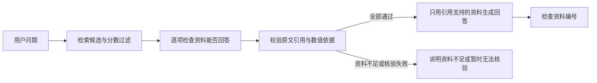

# RAG 证据核验与扩展评测 v4

## 实际行为

RAG 问答入口 `POST /api/rag/ask` 和 `scripts/run_rag_demo.py` 使用以下流程：



排序分数只用于选择候选，不作为回答可信概率。模型核验要求将原问题的实质要求逐项列出，每项附上来源编号和连续原文。程序检查布尔类型、来源编号、原文出处、具体数值问题的数值依据，以及生成回答的资料编号。只要任一项未获支持、返回格式不合法或核验服务不可用，本次就停止回答生成。

`used_model` 表示任何模型阶段是否调用；`verification_used_model` 和 `generation_used_model` 分别记录核验与生成。`candidate_count` 保留原始候选数量；`retrieved_count` 表示最终回答上下文中实际使用的来源数量。资料不足时返回零引用，避免相关但不足的片段被展示成答案证据。

简历与 JD 的规则分析仍复用原始检索候选生成方法建议。其技能覆盖分数不依赖本次模型核验，也不表示候选人经历已经由模型核实。

## 数据与评测

- 知识库现有 12 份文档：原两份指南、新增工程方法指南与明确标注为虚构的 Atlas/Mercury 演示契约。
- `evaluation/benchmark_v2_cases.json` 有 60 题，开发/测试各 30 题，各含 20 道可回答题与 10 道无答案题。
- 负例包含同主题缺失事实、其他对象的相似数字、复合问题只有部分资料和明显越域问题。
- 分块上限为 100/200/300 字符时分别有 39/24/14 个片段，候选库均明显大于最大 top-k=3。
- 各模式按开发集选择分块、top-k 和各自阈值。参数保存后才评估测试组；核验提示与实现指纹也进入范围清单。
- 报告同时给出核验前后证据覆盖、无答案过滤、可回答题空结果率，以及核验格式/引用无效和服务不可用情况。
- 核验服务故障会立即停止真实评测，并保留完成请求的缓存。恢复必须保持范围、输入、模型与实现一致。

两份原指南上的 30 题真实评测属于历史基线。扩大知识库后，难度与候选数量变化，新旧百分比不能当作同条件效果提升。本轮适合比较同一模式、相同输入下的原始检索和核验后结果。

## 运行

离线基线，不调用任何模型：

```powershell
.\.venv\Scripts\python.exe scripts/benchmark_evidence.py --run-dir data/reports/evidence-offline
```

仅生成真实评测范围（不会调用接口）：

```powershell
.\.venv\Scripts\python.exe scripts/benchmark_evidence.py --mode compare --gate model --prepare-scope data/reports/evidence-scope.json
```

检查范围后显式启动真实评测，可能产生 Embedding 与核验费用：

```powershell
.\.venv\Scripts\python.exe scripts/benchmark_evidence.py --mode compare --gate model --allow-live-calls --scope-manifest data/reports/evidence-scope.json --run-dir data/reports/evidence-live
```

真实评测使用本机配置的 Embedding 模型和聊天模型，仅核验可回答性，不生成最终回答。 SDK 自动重试关闭，脚本缓存复用已完成的输入。指定已有目录会尝试读取对应缓存；只有同一范围与实现可复用。不要把真实评测当作免费离线命令运行。

`text-embedding-v4` 的文本请求按每批最多 10 段拆分，并检查响应索引与跨批向量维度。[提供方批次限制](https://www.alibabacloud.com/help/en/model-studio/embedding)

## 验证与限制

2026-10-18 本地 Windows 环境完整回归 348 项通过，新增行为用例覆盖证据不足、数字缺失、复合问题、伪造原文、未知来源编号、核验异常、生成引用错误、API 实际装配与向量分批请求。

这些行为测试采用受控替身，不作为语义检索质量成绩。原文核对证明出处存在，不能从程序上证明引用与问题之间的语义蕴含关系；该判断仍依赖模型。自建题集也不能替代外部真实用户测试。最终回答中的所有事实尚未逐句做语义验证，因此不声称消除幻觉或达到生产可靠性。


## 开发集选择的问答默认配置

问答使用 RRF 加分数融合重排。候选配置按开发证据覆盖率优先选择，再比较开发证据 MRR 与空检索率；这与无核验时均衡覆盖和空检索的目标分开。

本轮冻结配置：分块上限 300 字符、14 个内置片段、top-k=3、候选阈值 0.75。RRF 常数 60，候选数 6，融合与字面重排权重为 0.7/0.3。API 与命令行演示共用同一服务工厂。该配置来自开发指标；测试结果不参与选择。上传文件保持原有带页码的切片方式，内置知识上的评测不代表任意上传文档的效果。

开发阶段还修正了数值槽位校验：子问题可以写成“文件数上限/大小上限”，无需重复“多少”这个问词。修正前源码和真实模型输出均保留，并用不联网的重放验证其影响。

## 最终真实回归（2026-10-18）

最后 30 题包含 20 道可回答和 10 道无答案题。问答核验后保留 17/20 可回答题，证据覆盖 85%，无答案空结果 10/10，核验异常 0；原始候选证据覆盖 100%，无答案空结果 0/10。仍有 3/20 误拒，全部保留在逐题报告。

核验提示增加问题粒度、否定答案与判定一致性规则后，从前一版本 9/20 误拒降至 3/20。这组数据已参与错误分析，因此属于回归验证，不能声称外部独立测试。全程 68 次向量、240 次核验，处于授权总上限内；没有生成最终回答。当前没有新的付费评测在后台运行。
